# 灵田灵草汇总

> 版本：2026-11-23，线上网页版 `77ec55b`（https://jackue4.github.io/-kk/ ，灵田 4×4 改版）。数值取自 `scripts/farm_data.gd` 的 `PLANTS` 表。
> 第三节的逐种阶段图是改版前拍的：各阶段的样子和时间没变，改版后整体放大了约四成、刚种下的嫩芽最少 1.35 米（见第七节）。

灵田在 **灵田农场东侧的种植区**，共 **6 块灵田、每块 4×4 = 16 格**（一格种一株，全开 96 格），现在能种 **9 种灵植**：

- **5 种灵草**：和搜打撤里掉的是同一样东西。
- **4 种灵果**：只有灵田能种。

种下以后按**真实时间**生长，**下线也照样长**。模型会随进度换阶段。东西收进洞府仓库。

**操作**（农场里右下角的「攻」换成种植按钮，桌面是底部按钮 / J / 鼠标左键 / T）：

| 站在哪 | 按钮 | 按下去 |
|---|---|---|
| 不在灵田上，或手里没拿灵种、这块地没空格 | 整备 | 右侧打开灵种背包（灵草 / 灵果两页，每种带图标和成熟时间），点一种再点「选择」拿到手上 |
| 拿着灵种站在有空格的灵田上 | 播种 | 种离自己最近的一格（灵种价当场扣）；按住不放一格格接着种 |
| 这块灵田里有熟了的 | 收获 | 一下收完这块地所有熟了的，头顶飘「+N」小条；仓库满了收到哪算哪，余下的留在地里 |

农场里不出招：御 / 剑 / 诀 / 罡 / 阵 收起来，出了农场复原。

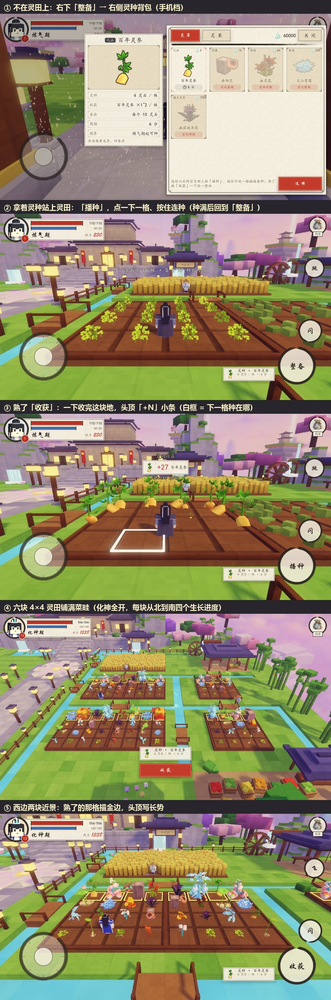

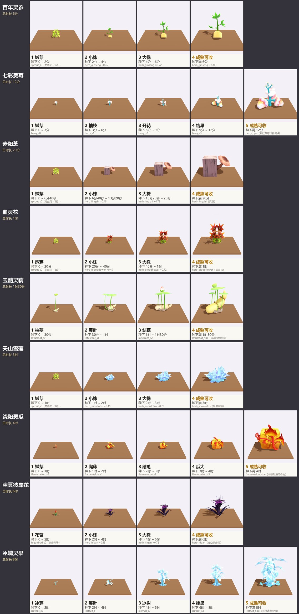

---

## 一、灵植一览

| # | 名称 | 类别 | 品阶 | 需要境界 | 灵种价（灵石） | **总成熟时间** | 生长阶段 | 一次收获 | 单件卖价 | 主要用途 |
|---|---|---|---|---|---:|---|---|---|---:|---|
| 1 | 百年灵参 | 灵草 | 凡品 | 炼气 | 4 | **6 分** | 3 段 + 成熟 | 1~2 株 | 10 | 丹房炼黄龙丹、回春丹 |
| 2 | 七彩灵莓 | 灵果 | 凡品 | 炼气 | 6 | **12 分** | 4 段 + 成熟 | 1~2 颗 | 12 | 辅药：中品黄龙丹 / 聚灵丹 |
| 3 | 赤阳芝 | 灵草 | 灵器 | 筑基 | 16 | **20 分** | 3 段 + 成熟 | 1~2 株 | 42 | 丹房炼聚灵丹 |
| 4 | 血灵花 | 灵草 | 法宝 | 结丹 | 64 | **1 时** | 3 段 + 成熟 | 1~2 株 | 168 | 丹房炼养元丹 |
| 5 | 玉髓灵藕 | 灵果 | 法宝 | 结丹 | 80 | **1 时 30 分** | 3 段 + 成熟 | 1~2 节 | 192 | 辅药：中品养元丹 |
| 6 | 天山雪莲 | 灵草 | 古宝 | 元婴 | 240 | **3 时** | 3 段 + 成熟 | 1~2 株 | 630 | 丹房炼凝魂丹 |
| 7 | 炎阳灵瓜 | 灵果 | 古宝 | 元婴 | 300 | **4 时** | 4 段 + 成熟 | 1 个 | 720 | 辅药：中品凝魂丹 |
| 8 | 幽冥彼岸花 | 灵草 | 通天灵宝 | 化神 | 1000 | **6 时** | 3 段 + 成熟 | 1~2 株 | 2625 | 丹房炼培婴丹 |
| 9 | 冰魄灵果 | 灵果 | 通天灵宝 | 化神 | 1200 | **8 时** | 4 段 + 成熟 | 1 个 | 3000 | 辅药：中品培婴丹 |

- **品阶越高，长得越久**：从 6 分钟到 8 小时。同一品阶里，灵果比灵草长得久一些。
- **境界门槛**：境界不够时，选种面板里那一项是灰的，写着「需 X 期」。
- **卖价**：在洞府仓库里直接卖的价格。灵草按品阶价值的 35% 算，灵果按 40% 算。

---

## 二、每个阶段的时间

生长期平均分成几段：一共 N 段时，第 k 段在「总时长 × (k−1)/N」开始。到总时长时变成成熟的样子，可以收获。
每段里模型还会从 82% 慢慢长到 100% 大小，不是到点才跳一下。

| 名称 | 第 1 段 | 第 2 段 | 第 3 段 | 第 4 段 | **成熟可收** |
|---|---|---|---|---|---|
| 百年灵参 | 0 ~ 2 分（嫩芽） | 2 ~ 4 分（小株） | 4 ~ 6 分（大株） | — | **6 分** |
| 七彩灵莓 | 0 ~ 3 分（嫩芽） | 3 ~ 6 分（抽枝） | 6 ~ 9 分（开花） | 9 ~ 12 分（结果） | **12 分** |
| 赤阳芝 | 0 ~ 6 分 40 秒（嫩芽） | 6 分 40 秒 ~ 13 分 20 秒（小株） | 13 分 20 秒 ~ 20 分（大株） | — | **20 分** |
| 血灵花 | 0 ~ 20 分（嫩芽） | 20 ~ 40 分（小株） | 40 分 ~ 1 时（大株） | — | **1 时** |
| 玉髓灵藕 | 0 ~ 30 分（抽茎） | 30 分 ~ 1 时（展叶） | 1 时 ~ 1 时 30 分（结藕） | — | **1 时 30 分** |
| 天山雪莲 | 0 ~ 1 时（嫩芽） | 1 ~ 2 时（小株） | 2 ~ 3 时（大株） | — | **3 时** |
| 炎阳灵瓜 | 0 ~ 1 时（嫩芽） | 1 ~ 2 时（爬藤） | 2 ~ 3 时（结瓜） | 3 ~ 4 时（瓜大） | **4 时** |
| 幽冥彼岸花 | 0 ~ 2 时（花苞） | 2 ~ 4 时（小株） | 4 ~ 6 时（大株） | — | **6 时** |
| 冰魄灵果 | 0 ~ 2 时（冰芽） | 2 ~ 4 时（展叶） | 4 ~ 6 时（冰树） | 6 ~ 8 时（挂果） | **8 时** |

> 括号里的阶段名是本文档为了说明起的。游戏里头顶的字只写「名字 · 还要 X」，成熟后写「名字 · 可收获」。

---

## 三、逐种截图（游戏内比例，每格写了阶段、时刻、用的模型）

### 1. 百年灵参（凡品灵草 · 炼气 · 6 分）
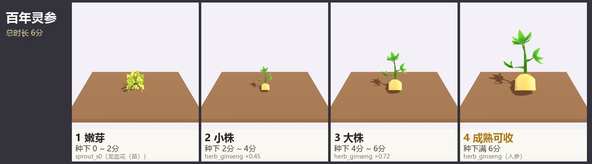

### 2. 七彩灵莓（凡品灵果 · 炼气 · 12 分）
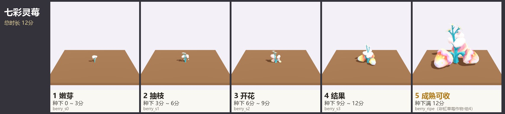

### 3. 赤阳芝（灵器灵草 · 筑基 · 20 分）
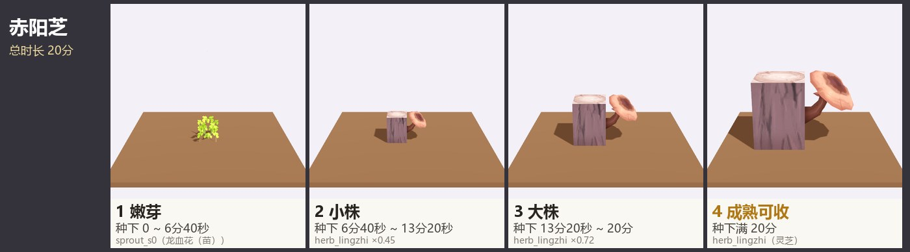

### 4. 血灵花（法宝灵草 · 结丹 · 1 时）
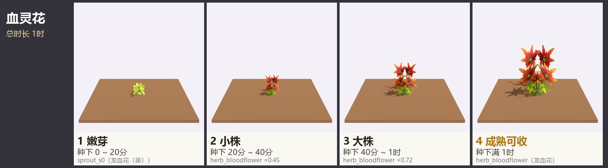

### 5. 玉髓灵藕（法宝灵果 · 结丹 · 1 时 30 分）
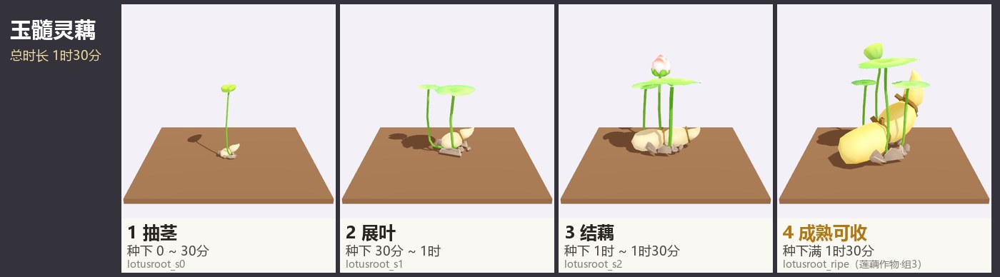

### 6. 天山雪莲（古宝灵草 · 元婴 · 3 时）
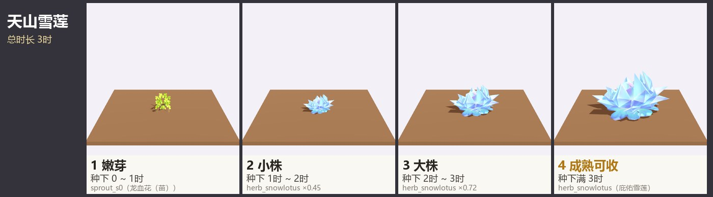

### 7. 炎阳灵瓜（古宝灵果 · 元婴 · 4 时）
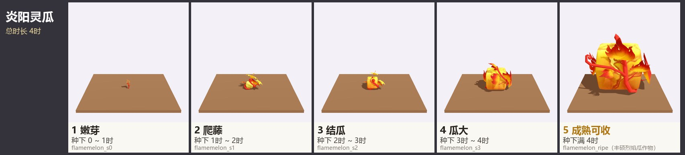

### 8. 幽冥彼岸花（通天灵宝灵草 · 化神 · 6 时）
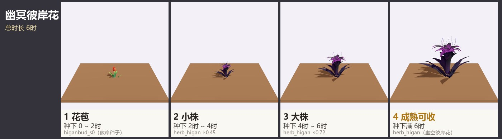

### 9. 冰魄灵果（通天灵宝灵果 · 化神 · 8 时）
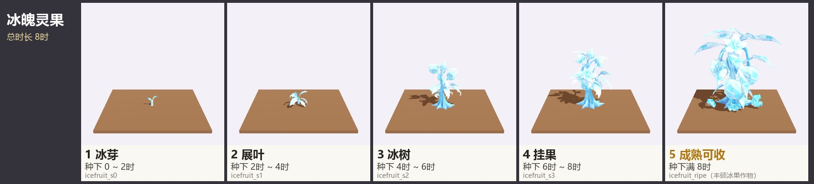

### 游戏里的灵田
六块 4×4 灵田全开（化神），每块从北到南四排是四个生长进度：

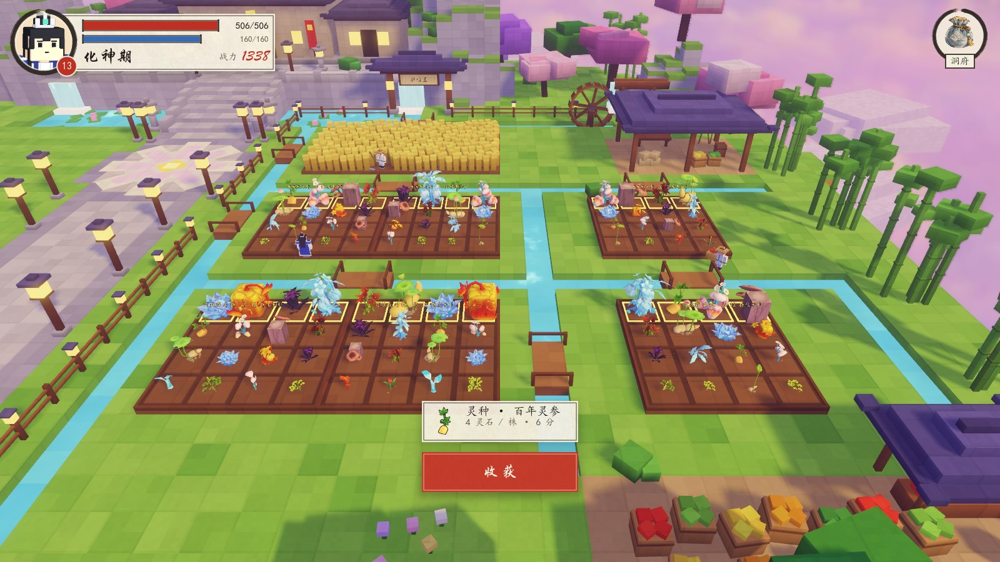

下面两张是改版前（十二块单格地）拍的，留作对照：同一片地在 5 个进度下的样子，以及当时的选种面板：

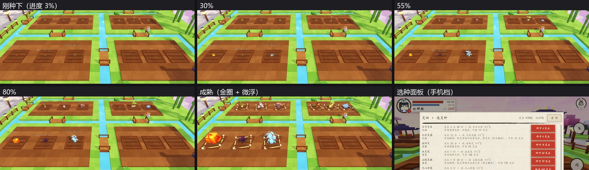

九种都成熟时的特写（改版前）。现在成熟的那一格土垄描一圈金边，每块地头顶写「可收获 N 株」：

---

## 四、用到的模型（都来自 `H:\游戏资源\miniw_assets`）

| 灵植 | 生长阶段用的模型 | 成熟用的模型 | 素材库来源 |
|---|---|---|---|
| 百年灵参 | 通用嫩芽 → 人参模型 ×0.45 → ×0.72 | 人参 | 嫩芽：`07_方块模型/龙血花（苗）`；人参：`07_方块模型/人参`（`assets/creatures/herb_ginseng.glb`，搜打撤掉落物原来就在用） |
| 赤阳芝 | 通用嫩芽 → 灵芝 ×0.45 → ×0.72 | 灵芝（长在木桩上） | `07_方块模型/灵芝`（`herb_lingzhi.glb`） |
| 血灵花 | 通用嫩芽 → 龙血花 ×0.45 → ×0.72 | 龙血花 | `07_方块模型/龙血花`（`herb_bloodflower.glb`） |
| 天山雪莲 | 通用嫩芽 → 雪莲 ×0.45 → ×0.72 | 庇佑雪莲 | `07_方块模型/庇佑雪莲`（`herb_snowlotus.glb`） |
| 幽冥彼岸花 | 彼岸花苞 → 彼岸花 ×0.45 → ×0.72 | 虚空彼岸花 | 花苞：`07_方块模型/彼岸种子`；花：`07_方块模型/虚空彼岸花`（`herb_higan.glb`） |
| 七彩灵莓 | 彩虹草莓作物 默认组、组 1、组 2、组 3 | 彩虹草莓作物 组 4 | `07_方块模型/彩虹草莓作物_200172` |
| 玉髓灵藕 | 莲藕作物 默认组、组 1、组 2 | 莲藕作物 组 3 | `07_方块模型/莲藕作物_200131` |
| 炎阳灵瓜 | 烈焰瓜作物 默认组、组 1、组 2、组 3 | 丰硕烈焰瓜作物 | `07_方块模型/烈焰瓜作物_200189`、`丰硕烈焰瓜作物_200192` |
| 冰魄灵果 | 冰果作物 默认组、组 1、组 2、组 3 | 丰硕冰果作物 | `07_方块模型/冰果作物_200185`、`丰硕冰果作物_200188` |

- 五味灵草在素材库里只有成熟形态。所以前面的阶段是先用嫩芽或花苞，再把成熟模型按 0.45、0.72 的比例缩小来过渡。
- 四种灵果用的是素材库里自带的成套生长阶段：「X作物」目录下的「非默认组」就是生长阶段。
- 灵果各阶段的 GLB 原本各嵌一份同样的贴图。我用 `_tasks/farm_plants/make_plants.py` 把贴图抽成一张共用，放在 `assets/plants/`。

---

## 五、收获以后能干什么

收获的东西进**洞府仓库**。仓库满了就先留在地里，不会丢。

**洞府丹房**里能做这些：

| 品阶 | 下品修为丹（原有丹方） | 中品修为丹（这次新增，药力翻倍） |
|---|---|---|
| 凡品 | 百年灵参 ×1 + 20 灵石 → 下品黄龙丹（修为 66） | 百年灵参 + 七彩灵莓 + 40 灵石 → 中品黄龙丹（修为 132） |
| 灵器 | 赤阳芝 ×1 + 60 灵石 → 下品聚灵丹（168） | 赤阳芝 + 七彩灵莓 + 120 灵石 → 中品聚灵丹（336） |
| 法宝 | 血灵花 ×1 + 160 灵石 → 下品养元丹（432） | 血灵花 + 玉髓灵藕 + 320 灵石 → 中品养元丹（864） |
| 古宝 | 天山雪莲 ×1 + 400 灵石 → 下品凝魂丹（1116） | 天山雪莲 + 炎阳灵瓜 + 800 灵石 → 中品凝魂丹（2232） |
| 通天灵宝 | 幽冥彼岸花 ×1 + 900 灵石 → 下品培婴丹（2868） | 幽冥彼岸花 + 冰魄灵果 + 1800 灵石 → 中品培婴丹（5736） |

- 还能用 **百年灵参 ×1 + 10 灵石** 炼回春丹（回 60 气血）。
- 修为丹服下就涨修为。服丹仍受丹毒影响，药力会打折。
- 灵草和灵果也可以在仓库直接卖成灵石。

---

## 六、灵田块数和境界

| 境界 | 炼气 | 筑基 | 结丹 | 元婴 | 化神 |
|---|---|---|---|---|---|
| 可用灵田 | 1 块（16 格） | 2 块（32 格） | 3 块（48 格） | 4 块（64 格） | 6 块（96 格） |
| 新解锁的灵种 | 百年灵参、七彩灵莓 | 赤阳芝 | 血灵花、玉髓灵藕 | 天山雪莲、炎阳灵瓜 | 幽冥彼岸花、冰魄灵果 |

没开垦的地上长着荒草，插一块牌子写「X期开垦」。

---

## 七、现状说明

- 生长时间、灵种价、产量、卖价都是**第一版**，还没并进数值框架（`_tasks/numbers_sim/life_sim.gd`）和整体节奏一起校准。数都集中在 `scripts/farm_data.gd` 的 `PLANTS` 表里。
- 还没做：浇水 / 草木灰加速、搜打撤里掉灵种、灵宠区的玩法。
- 植株大小：一格 2.4 米，成熟 2.35~3.0 米；生长中的最小 1.35 米（素材里的嫩芽本身很小，按比例缩出来几乎看不见，所以设了下限）。五味灵草的嫩芽用的是同一个通用嫩芽。
- 灵种价、产量按**每株**算；改成 4×4 以后一块地的产出是原来一块的 16 倍，仓库只有 60 格，一块地收一次就能占掉十几到三十格。这块要和数值一起定。
- 没在手机真机上测过。网页版第一次种某种新灵植时可能卡一下（要现场编着色器），没量过。
